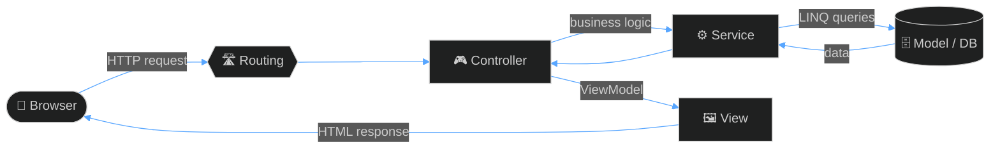
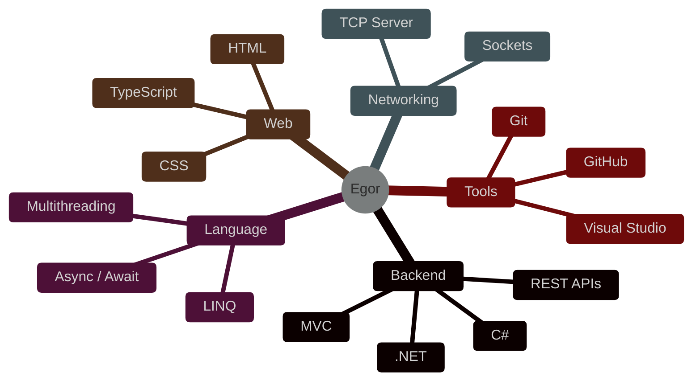

 

---

## 🚀 About Me

<table align="center">
  <tr>
    <td>💻 Building with <b>C# / .NET</b></td>
    <td>🎬 Passionate about <b>cinema & media</b> projects</td>
  </tr>
  <tr>
    <td>🧠 Exploring <b>architecture, MVC, LINQ & multithreading</b></td>
    <td>🌍 Based in <b>Stuttgart, Germany</b></td>
  </tr>
  <tr>
    <td colspan="2" align="center">⚡ Always open to new ideas and collaborations</td>
  </tr>
</table>

---

## 🛠 Tech Stack

  

---

## 🧩 How My Web Apps Work

---

## 🧠 What I'm Exploring

---

## 📊 GitHub Stats

  
  

  

  

---

## 🐍 Contribution Snake

  <picture>
    <source media="(prefers-color-scheme: dark)" srcset="https://raw.githubusercontent.com/b1mq/b1mq/output/github-snake-dark.svg" />
    <source media="(prefers-color-scheme: light)" srcset="https://raw.githubusercontent.com/b1mq/b1mq/output/github-snake.svg" />
    
  </picture>

---

## 🏆 Trophies

  

---

## 📌 Featured Projects

  
  

  
  

---

## 🖥️ My Workspace

  
  
  

---

## 📬 Connect

  
  
  

